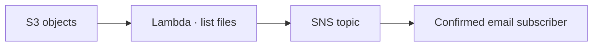
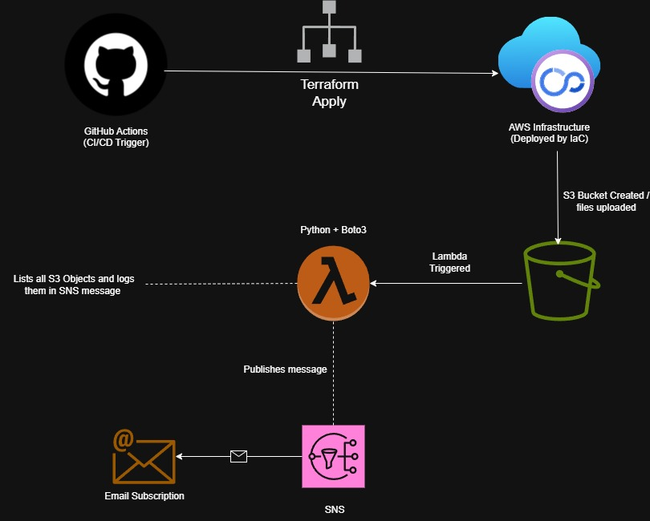

# AWS Lambda S3 Notification 

## At a glance




## 📌 Project Overview

This project demonstrates a fully automated serverless application deployed using **Terraform** and **GitHub Actions**. It includes:

- Provisioning an **S3 bucket** and uploading local files from `sample_files/`
- Creating an **SNS topic** with an **email subscription**
- Deploying a **Lambda function** that:
  - Lists objects in the S3 bucket
  - Sends the file list via email through SNS
  - Can be triggered manually (CLI) or automatically (on S3 upload)
  
### 📂 sample_files Folder

This folder contains test files that are automatically uploaded to the S3 bucket during deployment.
These files are later listed by the Lambda function and included in the email notification.

---

## 🗂️ Project Structure

```
.
│
├── scripts
│   ├── init_state_bucket.sh
│   ├── plan_invoke.sh
│   └── lambda_test.sh
│ 
├── sample_files
│   ├── dummy_test
│   ├── git_test_after_rearrange
│   .
│   .
│   └── some test files
│ 
├── terraform
│   ├── backend.tf
│   ├── iam.tf
│   ├── lambda.tf
│   ├── lambda_function.py
│   ├── locals.tf
│   ├── provider.tf
│   ├── s3.tf
│   ├── sns.tf
│   └── variables.tf
│ 
├── requirements
├── IaC.jpg
└── README.md
              
```
---
## 🖼️ Project Architecture Diagram

---


## 📋 Requirements

Make sure to install Python dependencies for the Lambda function and manual test:

### 1. Create and activate a virtual environment

```bash
python3 -m venv .venv
source .venv/bin/activate  # On Windows use: .venv\Scripts\activate
```
---
### 2. Install boto3 (for both local test and Lambda packaging)

```bash
pip install boto3
```
---

## 🚀 Deployment Instructions

### 1. Clone the Repository

```bash
git clone https://github.com/Fadi7AY/DevOps_Assignment
cd DevOps_Assignment/terraform
```

### 2. Configure AWS Credentials

Ensure your AWS credentials are configured either through:

- `aws configure`  
- Or by exporting them as environment variables in GitHub Actions:
  - `AWS_ACCESS_KEY_ID`
  - `AWS_SECRET_ACCESS_KEY`
---
### 3. Deploy with Terraform Locally

```bash
terraform init
terraform apply
```
---
### 4. Deploy with GitHub Actions (CI/CD)

- Go to the **Actions** tab in your GitHub repo
- Select the workflow and click **Run workflow** to deploy infrastructure

### ⚙️ GitHub Actions CI/CD Workflow

The workflow in `.github/workflows/deploy.yml` automates the infrastructure deployment process:

- Initializes Terraform
- Applies the infrastructure
- Runs on manual trigger via `workflow_dispatch`
---
### 5. Confirm Your Email

⚠️ **IMPORTANT:**  
After your first deployment, AWS SNS will send a **confirmation email** to the address you specified.  
You **must click the confirmation link** inside this email to start receiving notifications.

---

## 🧪 Manually Test Lambda

Use the provided shell script to invoke the Lambda function:

```bash
./scripts/lambda_test.sh
cat response.json
```

---

## 🛠 Tools Used

- **Terraform** – Infrastructure as Code
- **GitHub Actions** – CI/CD pipeline
- **AWS Lambda** – Serverless compute
- **AWS S3** – Object storage
- **AWS SNS** – Notification service
- **AWS IAM** – Access control
